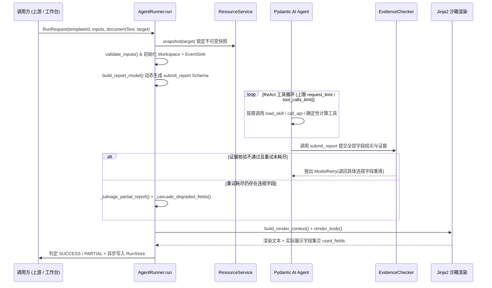

# 单智能体请求处理管道

<!-- #Created By AiCoding(codex) -->

本页说明一次申告报告生成请求从 HTTP/SSE 入口进入 `AgentRunner.run` 到最终落盘返回的全链路执行机制，重点解析资源快照隔离、动态交卷 Schema、重试挽救与三级状态（`SUCCESS` / `PARTIAL` / `FAILED`）判定。

## 1. 入口与运行模式

平台提供两类运行入口，底层均统一委托给 `src/report_agent/runtime/runner.py#AgentRunner.run`：

| 入口场景 | HTTP 路由 | 鉴权方式 | 默认目标版本（`target`） | 事件推送方式 |
|----------|-----------|----------|-------------------------|--------------|
| **上游业务调用** | `POST /api/v1/reports`、`/reports/stream` | 请求头 `X-API-Key` | 固定 `"online"`（线上快照） | 同步 JSON 或 SSE `text/event-stream` |
| **工作台试运行** | `POST /api/v1/templates/{id}/dryrun`、`/dryrun/stream` | 会话 Cookie / Bearer Token | `"draft"`（草稿叠加视图）或 `"online"` | 同步 JSON 或 SSE `text/event-stream` |

在流式接口中，路由层通过 `asyncio.Queue` 注入 `on_event` 回调，每产生一条 `ProcessEvent` 即推送 `event: event`，每 15 秒发送 `: keep-alive` 注释保活，结束后推送 `event: final`。客户端中途断开连接不会取消后台正在执行的 `AgentRunner` 任务，确保运行记录完整落盘。

## 2. 七步执行主流程

### 第 1 步：捕获不可变资源快照

`ResourceService.snapshot(req.target)` 在运行开始瞬间锁定本次请求使用的模板、Skill 字典、接口契约字典、系统提示词与版本号（如 `r3` 或 `r3+草稿`）。即使运行途中其他人在工作台发布了新版本，正在执行的请求也不会发生上下文撕裂。

- 若模板不存在或已被标记为下线（`tpl.offline == True` 且 `target != "draft"`），直接抛出 `TemplateUnavailableError`（HTTP 404）。

### 第 2 步：入参快速校验与工作区创建

- `validate_inputs(tpl, req.inputs)` 按 `template.yaml` 中 `inputs` 定义的 `required` 与 `pattern` 正则逐项校验，不合法时立即抛出 `InputValidationError`（HTTP 400 `INVALID_INPUT`），不消耗任何模型 Token。
- 创建请求级隔离的 `Workspace` 与 `EventSink`（`src/report_agent/runtime/workspace.py`），负责将单据按行编号（`L001`、`L002`…）、缓存每次网关调用的完整报文与记录（`r1`、`r2`…）、记录每次工具调用的输入输出（`t1`、`t2`…），并按序号发出过程事件。

### 第 3 步：动态构建交卷模型（`submit_report`）

`src/report_agent/runtime/output_model.py#build_report_model` 根据当前模板的 `fields` 动态生成 Pydantic 模型，配置 `extra="forbid"`（对应 OpenAI Structured Outputs `additionalProperties: false`）：

- **标量字段**（`string` / `enum` / `date`）：`value` 类型为 `str | None`（枚举字段生成 `Literal[...]` 约束可选值）；
- **列表字段**（`list`）：先根据 `columns` 动态生成行模型 `{字段名}Row`（每列 `str` 或枚举 `Literal[...]`），再将字段 `value` 声明为 `list[RowModel] | None`；
- 每个字段均固定包含四个属性：`status`（`"found"` | `"not_found"`）、`value`、`evidence`（`list[Evidence]`）与 `reasoning`（`str`）。

关于交卷输出通道（`AGENT_OUTPUT_MODE`，见 `runner.py#_build_output_type`）：
- 默认 `tool`：通过 `ToolOutput(report_model, name="submit_report", strict=settings.llm_strict_tools)` 注册交卷工具，兼容 DeepSeek、通义千问、vLLM 等各类 OpenAI 兼容服务端；
- 可选 `native` / `json_object` / `prompted`：分别对应 `NativeOutput(report_model, strict=settings.agent_native_strict)`、JSON 对象模式与提示词提取模式。

### 第 4 步：提示词注入与渐进式 Skill 披露

- **静态系统提示词 + 动态任务说明**（`prompt.py#build_task_instructions`）：加载 `system-prompt.md`，并在动态 `instructions` 中仅把当前模板 `skills` 白名单内的 Skill **标识 + 中文标题 + 一句话描述**与白名单接口渲染进目录，不一次性塞入全部 11 个 `SKILL.md` 正文。模型只在需要某个字段时调用 `load_skill` 按需加载。
- **用户提示词**（`prompt.py#USER_PROMPT`）：配合任务说明注入模板全部待填字段的规则与证据要求（含 `visible: false` 的中间依赖字段）、结构化入参 JSON 以及带行号的单据文本。

### 第 5 步：ReAct 工具循环与并发限额保护

- 平台级 `asyncio.Semaphore(settings.agent_max_concurrent_runs)` 限制全局并发运行数（默认 `8`），防止突发流量打满下游大模型或网关。
- Pydantic AI `UsageLimits` 强制约束单次运行的 `agent_request_limit`（默认 25 轮模型请求）与 `agent_tool_calls_limit`（默认 40 次工具调用），外层包裹 `asyncio.timeout(settings.agent_run_timeout_s)`（默认 600s）超时保护。

### 第 6 步：证据核验、精确重填与级联部分挽救

模型每次交卷都会进入 `@agent.output_validator`：

1. `EvidenceChecker.check(report)` 逐字段核验状态、类型、格式与证据链（详见 [强证据核验机制](evidence-system.md)）。
2. 若存在违规项且未超过 `AGENT_OUTPUT_RETRIES`（默认 3 次），发出 `report_rejected` 事件，并抛出 `ModelRetry`——仅把违规字段名称及具体原因拼成反馈消息发回给模型，模型无需重跑已成功的网关查询，只需修正交卷参数。
3. 若达重试上限或外层捕获到 `UnexpectedModelBehavior`：
   - 验证器内达到重试上限（`ctx.retry >= settings.agent_output_retries`）时直接原位降级违规字段；外层异常时由 `_salvage_partial_report()` 从消息历史最后一次 `submit_report` 调用或文本载荷中挽救合法草稿；
   - 将所有未通过 `EvidenceChecker` 的字段强制改写为 `status="not_found", value=None, evidence=[]`，标记 `degraded_fields`；
   - `_cascade_degraded_fields()` 扫描其余原本合规的字段：只要某字段的 `evidence` 引用了 `{"type": "field", "name": X}` 且字段 `X` 已被降级，则将该下游字段一并递归降级为 `not_found`，防止“上游订购短信已被判伪、下游受理渠道仍保留错误推导”的不一致现象，并发出 `report_degraded` 事件。

### 第 7 步：Jinja2 渲染与三级运行状态判定

`build_render_context()` 与 `render_body()` 渲染出最终报告，并收集模板实际展示过的字段集合 `used_fields`（详见 [模板模型与渲染机制](template-and-rendering.md)）。平台据此精确划分三级状态：

| 状态 | 判定条件 | 典型场景 |
|------|----------|----------|
| `SUCCESS` | 运行未抛异常，且正文中**所有实际展示**的无固定默认值可见字段（`visible and whenMissing != "value" and name in used_fields`）均为 `status == "found"`（包括列表字段合法查得 0 行 `status="found", value=[]`） | 正常全部填出；或未找到的字段恰好落在未命中的 `` 分支内未展示；或列表查询确认无记录 |
| `PARTIAL` | 运行完成了渲染（含触发部分挽救），但存在至少一个**实际展示在报告中**且 `whenMissing != "value"` 的可见字段或列表字段为 `status == "not_found"`（记录在 `missingShown` 列表中） | 网关某账期报错导致 `充值流水` 为 `not_found` 且进入了展示分支；单据缺失某必填项留了占位符或空白 |
| `FAILED` | 模型连接超时、超过最大轮数/工具调用上限、无法从异常交卷中挽救任何合法结构，或模板渲染本身报错 | 大模型 502/超时、死循环触发 `UsageLimitExceeded` |

## 相关页面

- [强证据核验机制](evidence-system.md)
- [模板模型与渲染机制](template-and-rendering.md)
- [确定性平台工具设计](deterministic-tools.md)
- [AgentRunner 运行时组件剖析](../components/agent-runner.md)
- [ADR-001：采用单智能体自主规划 + 强证据校验替代 Java 三 Agent 编排](../decisions/adr-001-single-agent-and-evidence.md)
