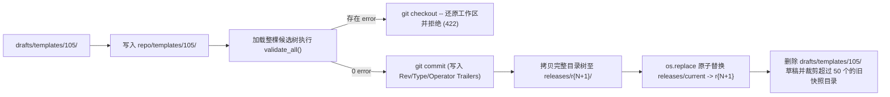

# 文件化资源存储与 Git 原子发布机制

<!-- #Created By AiCoding(codex) -->

`report-agent` 不依赖任何关系型数据库（如前代 Java 版的 Oracle / OceanBase），所有业务资源、草稿、发布快照、运行记录、回归用例与热更新配置全部存储在 `DATA_DIR` 文件系统中，通过内部 Git 仓库与 POSIX 原子软链接替换实现版本治理。

## 1. `DATA_DIR` 存储拓扑（`store/layout.py#DataLayout`）

```text
DATA_DIR/
├── repo/                        # 内部 Git 仓库（分支 main，仅存放已发布态资源树）
│   ├── templates/<id>/          # template.yaml + body.md.j2
│   ├── skills/<id>/             # SKILL.md
│   ├── apis/<name>.yaml         # 网关接口契约
│   └── system-prompt.md         # 系统提示词模板
├── drafts/                      # 草稿箱（按资源粒度独立存放，互不干扰）
│   ├── templates/<id>/          # 编辑中的副本 + .meta.json（baseRev, revision, updatedBy...）
│   ├── skills/<id>/
│   ├── apis/<name>/
│   └── system-prompt/
├── releases/                    # 不可变发布快照区
│   ├── index.jsonl              # 全局发布流水账（r1, r2, ...）
│   ├── r1/ ... rN/              # 每次发布导出的只读完整目录树 + .release.json
│   └── current -> rN            # 指向当前线上生效版本的相对路径软链接
├── runs/YYYY/MM/DD/             # 按日分区的运行索引 index.jsonl 与详情 <runId>.json
├── cases/<templateId>/          # 回归测试用例 <caseId>.yaml
├── mock-gateway/                # 本地覆盖的 Mock 响应报文
├── config/
│   ├── users.yaml               # 工作台用户与 PBKDF2 口令哈希
│   ├── .token-secret            # 会话签名密钥
│   └── runtime/                 # 运行期模型与网关热重载配置（0600 权限控制）
└── audit.jsonl                  # 全局操作审计日志
```

所有外部传入的标识符在拼装路径前均通过严格白名单正则校验（如 `SKILL_ID_RE = ^[a-z0-9][a-z0-9_-]{0,63}$`、`API_NAME_RE = ^[A-Za-z][A-Za-z0-9_-]{0,63}$`、`REV_RE = ^r[1-9]\d*$`），彻底阻断路径穿越（Path Traversal）。

## 2. 草稿叠加视图与乐观锁控制（`DraftStore` + `ResourceService`）

### 2.1 三种快照视图（`ResourceService.snapshot`）

1. **`"online"`（线上视图）**：直接加载 `releases/current` 指向的不可变目录树，并在内存中按当前激活的 `rev` 做缓存（软链接未切换时零磁盘重复解析开销）。所有上游 `/api/v1/reports` 请求固定读取此视图。
2. **`"rN"`（指定历史版本视图）**：加载 `releases/rN/`；若该早期快照目录因容量淘汰已被清理，`ReleaseStore.ensure_dir("rN")` 会自动根据 `index.jsonl` 中记录的 Git Commit SHA，调用 `git archive` 即时解压重建 `releases/rN/` 目录树。
3. **`"draft"`（草稿叠加视图）**：以当前线上快照为基底，将 `drafts/` 下所有存在的未发布草稿按 `(kind, key)` 覆盖上去（Overlay），供工作台在线预览与试运行（Dry-run）验证。

### 2.2 乐观锁防多人覆盖与基线漂移检测

每个草稿目录下的 `.meta.json` 维护两个关键版本字段：
- **`revision`（草稿递增修订号）**：每次保存草稿自动 `+1`。前端调用 `PUT .../draft` 时传入打开时读到的 `expected_revision`；若已被他人抢先保存，`DraftStore.save_files` 立即抛出 `DraftConflictError`（HTTP 409 `DRAFT_CONFLICT`），返回最新修改人与时间。
- **`baseRev`（草稿创建时的线上版本）**：若保存草稿期间其他人发布了同一资源的新版本，导致 `draft.baseRev != item.onlineRev`，`POST .../validate` 会返回 `drift` 漂移告警，提示维护人员对比线上变更后再发布。

## 3. 单点发布、原子切换与紧急回退（`Publisher` + `ReleaseStore`）

工作台支持**单资源粒度发布**（如只发布模板 `105`，而不把正在半途修改的模板 `112` 草稿带上线）：



关键工程保证：
- **并发发布串行化**：`Publisher` 内部持有进程级 `threading.Lock`，确保同一时刻只有一个发布/回退/下线操作修改 `repo/` 与分配递增版本号 `r{N+1}`。
- **全量交叉引用门禁**：即使只发布一个 Skill 或删除一个接口，也会把候选整棵资源树加载出来跑 `validate_all()`——若某线上模板仍在引用被删改的 Skill/API，发布会被 422 `PUBLISH_BLOCKED` 拦截并自动回滚 `repo/` 工作区。
- **POSIX 原子软链切换（`ReleaseStore.switch_current`）**：先在同目录创建临时软链 `.current.<pid>.tmp -> rN`，再调用 `os.replace` 原子覆盖 `current`。线上高并发读取在任何微秒都不会读到“写了一半的目录”或空指针。
- **两种回退手段**：
  - **资源级回退（`rollback_resource`）**：支持 `draft_only`（把历史版本内容提取为草稿先试跑）或 `publish_now`（生成新版本 `r{N+1}` 上线该资源的历史状态，不影响其它资源）；
  - **全局紧急切换（`emergency_switch`）**：不产生新版本，直接把 `releases/current` 软链接秒切回历史版本 `rK`，同时把 `repo/` 工作区对齐到 `rK`，用于线上突发故障秒级止血。

## 4. 异步运行记录存储（`RunStore`）与运行期热更新（`RuntimeConfigStore`）

### 4.1 `RunStore` 单写协程队列

每次报告运行结束后需要同时写入完整的 `<runId>.json`（附带脱敏处理，如打码 `Authorization` 头）并向当日 `runs/YYYY/MM/DD/index.jsonl` 追加一行摘要。`RunStore` 采用后台单 `asyncio.Queue` 顺序消费者落盘，既不阻塞响应返回，又避免高并发协程同时 `open(..., "a")` 造成 JSONL 行交错损坏。应用优雅停机（`lifespan` 退出）时调用 `await runs.stop()` 排空队列。

### 4.2 `RuntimeConfigStore` 在线热重载

`Settings` 环境变量提供启动基线，而管理员可通过工作台「系统设置」调用 `PUT /api/v1/settings/runtime` 动态覆盖大模型参数（`model`、`baseUrl`、`apiKey`、`temperature`、`timeoutS`、`outputMode` 等）与网关参数（`gatewayMode`、`gatewayUrl`、`gatewayXmlStyle` 等）：
- 配置持久化在 `DATA_DIR/config/runtime/`（含版本历史 `revisions/c1.json`..`cN.json`），所有含密钥文件与目录强制设置 `0600` / `0700` 权限；
- API 响应始终对密钥做掩码脱敏（仅显示状态与尾号），提交空密钥时自动继承上一版本已存密钥；
- 切换网关配置时，`ReloadableGatewayClient` 通过引用计数槽位（`_Slot`）让已在途的 HTTP 连接平滑执行完毕后再关闭旧 `httpx.AsyncClient`，新请求无缝切入新客户端。

## 相关页面

- [单智能体请求处理管道](request-pipeline.md)
- [ADR-003：采用文件系统 + 内部 Git 版本库 + releases/current 原子软链替代关系型数据库资源表](../decisions/adr-003-file-store-and-git-release.md)
- [网关契约与连接器组件剖析](../components/gateway-and-api-contract.md)
- [FastAPI 路由与鉴权组件剖析](../components/api-and-auth.md)
- [环境变量与运行期配置参考](../reference/configuration.md)
