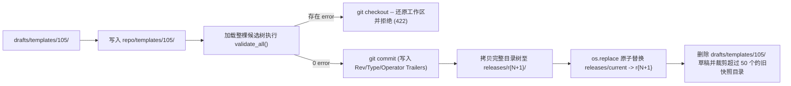

# 文件化资源存储与 Git 原子发布机制

<!-- #Created By AiCoding(codex) -->

`report-agent` 不依赖任何关系型数据库（如前代 Java 版的 Oracle / OceanBase），所有业务资源、草稿、发布快照、运行记录、回归用例与热更新配置全部存储在 `DATA_DIR` 文件系统中，通过内部 Git 仓库与 POSIX 原子软链接替换实现版本治理。

## 1. `DATA_DIR` 存储拓扑（`store/layout.py#DataLayout`）

```text
DATA_DIR/
├── repo/                        # 内部 Git 仓库（分支 main，仅存放已发布态资源树）
│   ├── templates/<id>/          # template.yaml + body.md.j2
│   ├── skills/<id>/             # SKILL.md
│   ├── apis/<name>.yaml         # 网关接口契约
│   └── system-prompt.md         # 系统提示词模板
├── drafts/                      # 草稿箱（按资源粒度独立存放，互不干扰）
│   ├── templates/<id>/          # 编辑中的副本 + .meta.json（baseRev, revision, updatedBy...）
│   ├── skills/<id>/
│   ├── apis/<name>/
│   └── system-prompt/
├── releases/                    # 不可变发布快照区
│   ├── index.jsonl              # 全局发布流水账（r1, r2, ...）
│   ├── r1/ ... rN/              # 每次发布导出的只读完整目录树 + .release.json
│   └── current -> rN            # 指向当前线上生效版本的相对路径软链接
├── runs/YYYY/MM/DD/             # 按日分区的运行索引 index.jsonl 与详情 <runId>.json
├── chats/<sid[:2]>/             # 嵌入式聊天窗口按哈希二级分片的会话文件 <sessionId>.json
├── cases/<templateId>/          # 回归测试用例 <caseId>.yaml
├── mock-gateway/                # 本地覆盖的 Mock 响应报文
├── config/
│   ├── users.yaml               # 工作台用户与 PBKDF2 口令哈希
│   ├── .token-secret            # 会话签名密钥
│   └── runtime/                 # 运行期模型与网关热重载配置（0600 权限控制）
└── audit.jsonl                  # 全局操作审计日志
```

所有外部传入的标识符在拼装路径前均通过严格白名单正则校验（如 `SKILL_ID_RE = ^[a-z0-9][a-z0-9_-]{0,63}$`、`API_NAME_RE = ^[A-Za-z][A-Za-z0-9_-]{0,63}$`、`REV_RE = ^r[1-9]\d*$`），并由 `store/layout.py` 提供双层路径边界守卫：内部读写走 `ensure_within`（强制校验 `resolve()` 真实路径包含性，拦截软链接越界读取），资源树摘除与覆盖前置清理走 `ensure_entry_within`（校验父目录真实路径包含性且不跟随末端软链接，安全摘除外部软链而不伤及外部目录）。底层磁盘写入统一收敛于 `store/fsutil.py`（`atomic_write_bytes` / `write_json` / `append_line` / `append_jsonl` / `append_audit` / `atomic_symlink`，支持 `mode=0o600` 在写入前先对临时文件描述符执行 `fchmod`、`fsync` 后再 `os.replace` 原子覆盖）。

## 2. 草稿叠加视图与乐观锁控制（`DraftStore` + `ResourceService`）

### 2.1 三种快照视图与读路径轻量化（`ResourceService` + `ReleaseStore` + `CaseStore`）

1. **`"online"`（线上视图）**：加载 `releases/current` 指向的不可变目录树并缓存在 `ReleaseStore._snapshots`（有界 LRU）中；提供微秒级同步快路径 `ReleaseStore.try_live_snapshot()`（仅执行 `os.readlink(current)` 并在缓存命中时零线程切换直返），同时按 `(mtime_ns, size)` 指纹缓存 `releases/index.jsonl` 与 `_by_rev` $O(1)$ 索引字典。所有上游 `/api/v1/reports` 请求固定读取此视图。
2. **`"rN"`（指定历史版本视图）**：加载 `releases/rN/`（对含 `.release.json` 的已物化快照，`read_file_at` 在目标文件如 `.offline` 不存在时直接返回 `None` 免除 `git show` 子进程开销；裁剪旧目录 `prune()` 先原子重命名至 `.prune-*` 再删除并在 `recover()` 兜底清理）；若该早期快照目录因容量淘汰已被清理，`ReleaseStore.ensure_materialized("rN")` 会自动根据 `index.jsonl` 中记录的 Git Commit SHA，调用 `git archive` 即时解压重建 `releases/rN/` 目录树。
3. **`"draft"`（草稿叠加视图）**：以当前线上快照为基底，将 `drafts/` 下所有未发布草稿按 `(kind, key)` 覆盖上去（Overlay）。`ResourceService.overlay()` 基于 `(live_rev, _draft_mutation_seq, _drafts_fingerprint())` 维护内存缓存（锁外计算指纹、读写缓存锁内双重核对 `_draft_mutation_seq` 与 `live_rev`），任意草稿写/删/发布/回滚递增序号立即失效，消除工作台试运行与详情查询重复扫盘开销；`CaseStore.count(template_id)` 采用 `os.scandir` + `(mtime_ns, size)` 指纹轻量头校验统计用例数，免除全量 `yaml.safe_load` 反序列化。

### 2.2 全粒度乐观锁防多人覆盖与基线漂移检测

每个草稿目录下的 `.meta.json` 维护两个关键版本字段：
- **`revision`（草稿递增修订号）**：每次保存或细粒度修改草稿自动 `+1`。不仅整包保存 `PUT .../draft` 校验 `revision`，细粒度字段/技能接口（`save_field`、`delete_field`、`batch_evidence`、`reorder_fields`、`update_skills` 及 `publish_system_prompt`）也统一支持传入 `revision` 乐观锁校验（不一致或草稿已被他人发布清空时返回 HTTP 409 `CONFLICT`），并在响应中返回最新 `revision` 与 `draft` 元信息。
- **`baseRev`（草稿创建时的线上版本）**：若保存草稿期间其他人发布了同一资源的新版本，导致 `draft.baseRev != item.onlineRev`，`POST .../validate` 会返回 `drift` 漂移告警，提示维护人员对比线上变更后再发布。

## 3. 单点发布、原子切换与紧急回退（`Publisher` + `ReleaseStore`）

工作台支持**单资源粒度发布**（如只发布模板 `105`，而不把正在半途修改的模板 `112` 草稿带上线）：



关键工程保证：
- **并发发布串行化**：`Publisher` 内部持有进程级 `threading.Lock`，确保同一时刻只有一个发布/回退/下线操作修改 `repo/` 与分配递增版本号 `r{N+1}`。
- **全量交叉引用门禁**：即使只发布一个 Skill 或删除一个接口，也会把候选整棵资源树加载出来跑 `validate_all()`——若某线上模板仍在引用被删改的 Skill/API，发布会被 422 `PUBLISH_BLOCKED` 拦截并自动回滚 `repo/` 工作区。
- **POSIX 原子软链切换（`ReleaseStore.switch_current`）**：先在同目录创建临时软链 `.current.<pid>.tmp -> rN`，再调用 `os.replace` 原子覆盖 `current`。线上高并发读取在任何微秒都不会读到“写了一半的目录”或空指针。
- **两种回退手段**：
  - **资源级回退（`rollback_resource`）**：支持 `draft_only`（把历史版本内容提取为草稿先试跑；若目标历史版本含 `.offline` 下线标记，显式返回 `targetOffline: True` 与 `warning` 提示）或 `publish_now`（生成新版本 `r{N+1}` 上线该资源的历史状态，不影响其它资源）；
  - **全局紧急切换（`emergency_switch`）**：不产生新版本，直接把 `releases/current` 软链接秒切回历史版本 `rK`，同时把 `repo/` 工作区对齐到 `rK`，用于线上突发故障秒级止血。

## 4. 异步运行记录存储（`RunStore`）与运行期热更新（`RuntimeConfigStore`）

### 4.1 `RunStore` 单写协程队列与按日索引缓存

每次报告运行结束后需要同时写入完整的 `<runId>.json`（附带脱敏处理，如打码 `Authorization` 头）并向当日 `runs/YYYY/MM/DD/index.jsonl` 追加一行摘要：
- **单写者队列与读己之写一致性**：采用后台单 `asyncio.Queue` 顺序消费者落盘（配合 `_write_lock` 串行化 `stop()` 排空与工作线程回退同步写），并在异步落盘完成前维护内存 `_pending` 映射保证即时查询可见，应用优雅停机（`lifespan` 退出）时调用 `await runs.stop()` 排空队列，`cleanup()` 同步清理空的月/年父目录；
- **启动孤儿恢复与增量分页缓存**：孤儿 `*.json` 扫描仅在 `RunStore.start()` 启动阶段执行一次并自愈补写索引；日常分页查询按单日 `index.jsonl` 的 `(mtime_ns, size)` 走有界 LRU `_day_cache`（上限 400 天），万条记录翻页维持毫秒级响应。

### 4.2 `RuntimeConfigStore` 在线热重载

`Settings` 环境变量提供启动基线，而管理员可通过工作台「系统设置」调用 `PUT /api/v1/settings/runtime` 动态覆盖大模型参数（`model`、`baseUrl`、`apiKey`、`temperature`、`timeoutS`、`outputMode` 等）、网关参数（`gatewayMode`、`gatewayUrl`、`gatewayXmlStyle` 等）及 `reportApiKeys`：
- 配置持久化在 `DATA_DIR/config/runtime/`（含版本历史 `revisions/c1.json`..`cN.json`；当 `current.json` 丢失但 `index.jsonl`/`revisions/c*.json` 存在时启动自动自愈恢复并通过 `cfg.validate()` 校验），所有含密钥文件与目录经 `fsutil.write_json(..., mode=0o600)` 强制保持 `0600` / `0700` 权限；
- API 响应始终对密钥做掩码脱敏并按不可变修订缓存脱敏视图（`_public_cfg_cache`），提交空密钥时自动继承上一版本已存密钥；
- 仅在网关签名参数（`_gateway_signature`）实际变更时才触发网关热切换，`ReloadableGatewayClient` 通过引用计数槽位（`_ClientSlot`）+ `asyncio.shield` 后台关闭任务让已在途的 HTTP 连接平滑执行完毕后再释放旧 `httpx.AsyncClient`，新请求无缝切入新客户端。

## 相关页面

- [单智能体请求处理管道](request-pipeline.md)
- [ADR-003：采用文件系统 + 内部 Git 版本库 + releases/current 原子软链替代关系型数据库资源表](../decisions/adr-003-file-store-and-git-release.md)
- [网关契约与连接器组件剖析](../components/gateway-and-api-contract.md)
- [FastAPI 路由与鉴权组件剖析](../components/api-and-auth.md)
- [环境变量与运行期配置参考](../reference/configuration.md)
