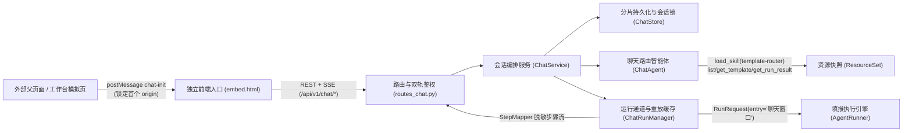

# 嵌入式聊天选模板窗口组件剖析

<!-- #Created By AiCoding(codex) -->

嵌入式聊天选模板窗口（`src/report_agent/chat/`、`src/report_agent/api/routes_chat.py` 与前端独立入口 `frontend/embed.html`）面向外部工单受理系统提供 **ChatGPT Web PC 端风格纯亮色单栏居中流式对话界面**，实现**免手工翻找模板、对话流内联补参、内联双视图观看填报进度与报告正文、页内全屏弹窗分栏对比微调后一键确认回传**的交互闭环，并在资源工作台中提供右侧全局多页签动态聊天窗口（`WorkspaceTabsBar.vue` + `ChatIframeTabPane.vue`）与 PC 左右双栏模拟联调台（`/#/chat-sim`）。

## 1. 端到端协作架构

核心分层边界：
- **聊天路由智能体（`ChatAgent`）不触碰业务网关**：仅读取 `template-router` Skill、在线模板元数据与本会话历史运行摘要，负责模板推荐、缺参追问、答疑与报告文本润色。
- **填报执行复用单智能体底座（`AgentRunner`）**：选定模板且入参合法后，仍由 `AgentRunner` 执行标准的接口取数、确定性工具计算与 `EvidenceChecker` 强证据核验，不在聊天层另起炉灶。

## 2. 父子页面 `postMessage` 握手、`origin` 锁定与页内 Tab 全幅承载

按契约 `docs/chat-embed-api.md`，推荐外部系统以页内全幅 Tab 页签承载无边框 `/embed.html?userId=<u>&orderId=<o>` `<iframe>`（`ChatEmbedApp.vue#getHostWindow` 优先绑定 `window.parent` 父级 iframe 宿主，亦兼容未关闭的 `window.opener` 回退）：

| 方向 | 消息 `type` | 关键载荷与安全规则 |
|------|-------------|--------------------|
| iframe → 父 | `chat-ready` | `{userId, orderId}`：挂载后每 500ms 发送一次直至收到 `chat-init`；10s 超时未收到则展示「未收到上层参数」提示 |
| 父 → iframe | `chat-init` | `{apiKey, inputs, document, target?}`：严格校验 `event.source === getHostWindow()`，并在首次收到 `chat-init` 时**锁定 `event.origin`**；后续仅接受该 `origin` 的重下发参数，且 `apiKey` 仅驻留内存（不写 `localStorage` / URL） |
| iframe → 父 | `report-confirmed` | `{userId, orderId, templateId, templateName, runId, status, markdown, edited, rewritten}`：`POST /runs/{runId}/confirm` 成功后以锁定的 `targetOrigin` 精确回传 |
| iframe → 父 | `chat-close-request` | 紧随 `report-confirmed` 发送，交由宿主页面关闭对应页内 Tab 页签或隐藏 iframe |

- **管理端全局多页签动态聊天窗口与双栏模拟联调（`WorkspaceTabsBar.vue` + `ChatIframeTabPane.vue` + `ChatSimView.vue`）**：管理端右侧顶栏采用基于 Element Plus `ElTabs` 与 `SortableJS` 的全局工作区多页签栏；`/#/chat-sim` 采用清爽的 PC 左右双栏卡片布局（左栏配置父页面参数与单据，右栏可切换或上下分栏查看 `postMessage` 实时报文流与确认回传报告）。点击「在顶部新页签打开聊天窗口」时，在全局页签栏新增并激活 `智能填报 · <orderId>` 页签，由 `ChatIframeTabPane.vue` 以 `100% × 100%` 占满主内容区承载 `/embed.html` `<iframe>`（`v-show` 保活，切换业务模块页签不中断会话或 SSE 流），收到 `chat-close-request` 后自动关闭该聊天页签并切回 `聊天窗口模拟` 展示确认报告。

## 3. 会话存储、入参指纹演进与中断自愈（`chat/store.py` + `chat/service.py`）

- **确定性会话主键、二级分片与并发安全异步 I/O（`ChatStore`）**：`session_id_for(user_id, order_id)` 对 `f"{user_id.strip()}\x00{order_id.strip()}"` 计算 SHA-256 前 32 位十六进制串（`SESSION_ID_RE` 严格校验防路径穿越），落盘于 `DATA_DIR/chats/<sid[:2]>/<sid>.json`；写操作走 `fsutil.write_json` 原子替换，读操作维护容量 256 的 `OrderedDict` LRU 内存缓存并通过 64 分片会话文件锁（严格保持 `_stripe_lock -> _cache_guard` 锁序）与操作序号守卫串行化冷盘读取、落盘（`aget`/`asave` 卸载至工作线程）、只读 `has_run_id` 预筛（不污染 LRU）及过期清理 `ChatStore.cleanup(keep_days)`，消除 `cleanup()` 与活跃读写的已删会话复活竞态；应用层每个 `sessionId` 再经独立 `asyncio.Lock` 串行化会话状态变更。
- **草稿态防降级劫持与入参指纹演进（`ChatService.open_session`）**：同一 `(userId, orderId)` 再次打开时恢复原会话——若存量会话处于 `target="draft"`，仅持 `X-API-Key` 的 `ChatCaller(kind="key")` 即便传入 `target="online"` 也会被统一拦截返回 HTTP 403 `DRAFT_FORBIDDEN`；通过权限校验后比对 `inputs_fingerprint(inputs, document)`（自动忽略空白字符串键值以避免上层空串与省略键产生伪变更）：
  - 指纹不变：`inputsChanged=False`，无损恢复历史消息、推荐列表与确认状态；
  - 指纹变化：`inputsVersion += 1`、`inputsChanged=True`；入参合并遵循**「上层本次非空键值覆盖同名键并标为『上层』；上层此前传过但本次置空/移除的『上层』键同步移除；用户此前在对话或表单中补充过（`inputSources[k] == '用户补充'`）且上层本次未提供非空值的键予以保留」**（在 `start_run` 补参时亦支持传入空串清空此前误填的「用户补充」可选参数，同时保护「上层」入参不被空串冲掉）；同时将所有历史 `run` 卡片标记 `stale=True`（「旧入参」角标），并追加一条 `kind="divider"` 系统分隔消息。
- **进程重启中断恢复**：在 `open_session`、`get_session_view` 或 `stream_events` 读取会话时，若发现某张 `run` 卡片持久化状态仍为 `RUNNING` 但不在当前进程 `ChatRunManager` 活跃任务中，自动将其修正为 `INTERRUPTED`（附错误说明）并写回磁盘，避免前端永久卡死在运行态。

## 4. 聊天路由智能体与 `output_validator` 自愈（`chat/agent.py`）

`ChatAgent` 复用 `AgentRunner` 的底层模型配置（支持运行期热重载）与输出模式（默认 `ToolOutput` 工具名 `submit_chat_action`），每次对话输出严格校验的 `ChatAction`（`extra="forbid"`）：

| `action` | 触发场景 | 平台编排行为（`ChatService.send_message`） |
|----------|----------|-------------------------------------------|
| `reply` | 解释模板差异、说明某字段为何 `not_found`、礼貌拒绝无关闲聊 | 追加 `assistant` `text` 消息 |
| `recommend` | `auto=true` 首次打开自动分流，或用户询问适用模板 | 校验每个 `templateId` 在线且去重截断至最多 3 项，自动对照会话 `inputs` 补算每项的 `missingRequired` 必填缺口，产出 `recommend` 卡片 |
| `ask_params` | 用户想跑某模板但关键入参缺失或对话信息不足 | 调用 `_check_params` 生成带 `required`、`pattern`、`sample` 与当前 `error` 的 `ParamSpec` 列表，产出 `ask_params` 补参表单卡片 |
| `start_run` | 用户在对话中明确指定运行某模板（可顺带从自然语言抽取 `inputs`） | 若已有活跃运行则提示等待；否则合并补充入参后复用 `start_run`（缺参自动转 `ask_params`，合规直接启动后台运行并产出 `RUNNING` `run` 卡片） |
| `rewrite` | 用户要求对已生成的报告做措辞精简、分段调整或客服口径润色 | 校验目标 `runId` 属于本会话且处于 `SUCCESS`/`PARTIAL`，向该卡片 `versions` 追加 `kind="rewrite"` 新版本（标注「未经证据校验」）、将 `card["confirmed"]` 复位为 `False`（保留 `session["confirmed"]` 上一次已回传快照），先通过同消息 `id` upsert 推送更新后的 `run` 卡片，再追加携带 `rewriteRunId` 与 `rewriteVersionNo` 的 `assistant` `text` 回复消息，使前端在最新回复气泡下方直接渲染填充后的改写报告卡片 |

**防越界护栏**：
1. **只读受限工具集**：仅注册 `load_skill`（锁死仅允许加载 `template-router`）、`list_templates`、`get_template`、`get_run_result`（强制校验 `runId` 属于当前会话），不暴露任何外部网关工具；
2. **`CHAT_SYSTEM_PROMPT` 改写动作强约束**：明确要求当用户请求改写、润色、精简或调整已生成报告口径时（包括此前已点击确认的报告），必须使用 `action="rewrite"` 并在 `markdown` 提交完整报告正文、`text` 仅写简短说明，严禁使用 `action="reply"` 只口头声称已改写而不输出 `markdown`；
3. **`@agent.output_validator` 自愈**：若模型幻觉输出不存在或已下线的 `templateId`，或 `rewrite` 指向非本会话/无正文的运行，校验器直接抛出 `ModelRetry` 附带合法在线模板列表让模型当场修正。

## 5. 模板结构与样例预览（`chat/service.py#ChatService.get_template_preview`）

在用户点击运行前，推荐卡片与换模板弹窗均支持调用 `GET /api/v1/chat/sessions/{sid}/templates/{templateId}` 查看模板全貌：
- **权限与下线可见性**：校验会话存在与 `caller` 对会话 `target`（`online` / `draft`）的访问权限；若模板不存在返回 HTTP 404 `TEMPLATE_UNAVAILABLE`；若模板已下线（`tpl.offline == True`）仍允许返回预览并将 `"offline": True` 透传前端（提示不可发起新运行但可查阅历史模板结构）。
- **代表性样例预渲染（`sampleMarkdown`）**：遍历 `tpl.definition.fields`（含控制正文分支的 `visible=False` 中间字段）构造 `sample_ctx`——列表字段生成 1 行示例字典（枚举列取首项 `values[0]`，文本列取 `【列名】`），枚举字段取首项 `values[0]` 以激活 `body.md.j2` 中的代表性 `` 分支，其余标量字段优先取非空 `defaultValue` 否则填 `【字段名】`；调用 `render_body(tpl.body, sample_ctx)` 生成预填充样例正文（草稿语法异常时优雅回退 `tpl.body`）。
- **入参与可见字段清单**：合并当前会话 `inputs` 输出每个入参的 `currentValue`，仅返回 `visible=True` 的报告字段并自动剥离 `原规则（Java）：` 历史迁移对照后缀。

## 6. 后台运行通道、双视图进度流（脱敏步骤 + 原样记录）与断点续接（`chat/manager.py` + `chat/steps.py`）

- **单会话并发互斥**：`ChatService.start_run` 与 `ChatRunManager.start` 共同保证同一 `sessionId` 同时最多只有 1 个活跃运行，重复触发返回 HTTP 409 `RUN_IN_PROGRESS`；预先分配 `run_id = new_run_id()` 注入 `RunRequest(entry="聊天窗口", operator=f"chat:{userId}", run_id=run_id)`，使前端拿到 `RUNNING` 卡片即可立即订阅事件流，且运行记录在工作台「运行记录」视图中清晰标识入口为 `聊天窗口`。
- **双视图事件缓存与全链路异常脱敏**：
  - **精简脱敏步骤（`StepMapper` + `sanitize_error_text`）**：过滤内部的 `model_request` / `model_text` 推理原文，将其余 `ProcessEvent` 转换为连续递增 `seq = 1, 2, ...` 的中文步骤 `RunStep{seq, atMs, icon, text, ok}`；同时通过 `sanitize_error_text` 统一掩码 POSIX/Windows 本地路径、`Bearer`/`sk-` 等凭证、单双引号字面量与长数字/证件号（`send_message` 对 `TimeoutError` 单独返回友好超时提示，SSE 流 `_sse_chat_stream` 在中途抛 `ChatError` 或内部异常时可靠输出脱敏后的 `event: error` 帧）；
  - **原样运行记录（`_RunChannel.raw_events`）**：事件监听器 `_on_event` 将每条 `ProcessEvent.to_dict()` 追加至通道 `raw_events` 并触发 `_schedule_notify` 广播（即便 `StepMapper.feed` 返回 `None` 如 `model_request` / `model_text`，也能实时唤醒订阅了 `includeRaw=1` 的客户端），支持前端在运行卡片内一键切换「精简步骤 ↔ 原样记录」。
- **SSE 实时流与双级重放（`GET /runs/{runId}/events` + `GET /runs/{runId}/raw`）**：
  - `GET /runs/{runId}/events` 支持 `?after=N`（与 `Last-Event-ID` 请求头取较大值）及可选 `?includeRaw=1&rawAfter=M`：默认 `includeRaw=False` 仅推送带 `id: <seq>` 的 `step` 帧与 `final` 帧；开启 `includeRaw` 后额外推送无 `id` 的 `raw` 帧（避免污染浏览器 `EventSource` 的步骤 `Last-Event-ID` 游标），空闲每 15s 发送 `: keep-alive`；
  - 刚结束 10 分钟内的运行由 `ChatRunManager` 内存通道直接重放游标之后的 `raw` / `step` 并发送 `final`；超过内存保留窗口或服务重启后，`events`（当 `includeRaw=1` 时）与按需拉取接口 `GET /runs/{runId}/raw` 均在校验会话归属与 `draft` 权限后，自动回退从 `RunStore.get(run_id)` 读取持久化的 `events` 列表。
- **跨会话 `runId` 防越权绑定（`ChatService.resolve_session_for_run`）**：针对多个在线会话共用同一把 `X-API-Key` 的场景，`/runs/{runId}/{events,raw,cancel,confirm}` 支持可选请求头 `X-Chat-Session-Id` 或查询参数 `sessionId` 绑定校验当前会话（前端 `chatApi.ts` 自动携带），一旦传入非空值但格式非法或与 `runId` 实际所属会话不一致，统一返回 HTTP 404 `RUN_NOT_FOUND`。
- **手动停止（`POST /runs/{runId}/cancel`）**：取消后台 `asyncio.Task`；`AgentRunner.run` 捕获 `CancelledError` 先向 `RunStore` 提交取消记录再向上抛出，`ChatService` 将卡片落盘为 `CANCELLED` 并追加停止提示步骤。

## 7. 改写版本、三级确认门禁、幂等保护与 ChatGPT Web 单栏流式界面

- **版本栈与存量改写关联自愈（`ReportVersion` + `ChatService._build_view`）**：首次填报完成生成 `no=1, kind="original"`（经 `EvidenceChecker` 校验）；每次对话 `rewrite` 追加 `kind="rewrite"` 新版本并将对应运行卡片 `confirmed` 复位为 `False`，同时在末尾助手 `text` 消息写入 `rewriteRunId` 与 `rewriteVersionNo` 以便在最新回复气泡下直接内联展示改写报告卡片（对升级前未写入 `rewriteRunId` 的历史存量会话，`src/report_agent/chat/service.py#_backfill_legacy_rewrite_links` 在构造视图副本时按 `createdAt` 5 秒窗口与正文 `runId` 兜底做一对一自动补全，绝不误绑普通答疑消息）。前端运行卡片、改写回复卡片与预览弹窗均醒目提示改写版未经平台证据核验，同时允许人工在源码框或分栏对比弹窗中继续编辑文本。
- **确认门禁（`ChatService.confirm_run`）**：
  - `FAILED` / `RUNNING` / `CANCELLED` / `INTERRUPTED` 状态调用 `confirm` 一律返回 HTTP 400 `NOT_CONFIRMABLE`；
  - `PARTIAL` 状态（存在 `missingShown` 可见未找到字段）未显式传 `acknowledgePartial=true` 时返回 HTTP 409 `PARTIAL_NEEDS_ACK` 并附带 `missingShown` 清单，前端弹窗二次确认后携带 `acknowledgePartial=true` 方可通过；
  - 精确标记 `edited = (markdown != versions[-1].markdown)` 与 `rewritten = (versions[-1].kind == "rewrite")`。
- **幂等与审计留痕**：仅当目标运行卡片当前已处于 `card["confirmed"] == True` 且 `markdown` 与最近一次确认快照一致时才按幂等跳过落盘（若用户在确认 `v1` 后经 AI `rewrite` 生成 `v2` 复位了 `card["confirmed"]`，再切回 `v1` 确认仍会准确重算 `edited`/`rewritten` 并记录审计）；每次有效确认均记录会话内 `confirmRecords` 并通过 `audit("chat-confirm", ...)` 写入 `DATA_DIR/audit.jsonl`。
- **模板下线兼容**：当某模板在工作台被下线后，`get_session_view` 动态标记历史卡片 `templateOffline=True`——**允许用户继续预览和确认已生成的历史报告，但拦截新发起或重跑该模板（返回 HTTP 404 `TEMPLATE_UNAVAILABLE`）**。
- **ChatGPT Web 风格纯亮色单栏界面、独立轻量分包与页内全屏弹窗（`ChatEmbedApp.vue`）**：
  - **纯亮色单栏等比缩放舞台与零重型依赖分包**：页面固定为清爽明亮的纯亮色（`color-scheme: light`），默认启用桌面宽屏基准 `BASE_WIDTH = 1280`、`MIN_STAGE_HEIGHT = 640` 的等比缩放舞台（动态计算 `stageW = Math.max(BASE_WIDTH, vw / s)` 与 `stageH = vh / s` 100% 铺满视口而无灰边）；`embed.html` 构建彻底剥离 `ElementPlus` 与 `CodeMirror` 重型依赖（首屏体积缩减约 80%），以挂载于 `.embed-stage` 内同屏缩放的 `VersionSelect.vue`、`StageConfirmDialog.vue` 与零依赖 `stageToast.ts` 提供原生丝滑交互，并复用 `src/utils/sse.ts#readSseStream` 保证流提前结束或 `AbortController.abort()` 时可靠执行 `reader.cancel()`。
  - **居中对话流 + 内联卡片 + 三大页内全屏弹窗**：中央 `max-width: 840px` 消息流内联承载 `RecommendCard.vue`（推荐卡片）、`AskParamsCard.vue`（双列补参卡片）与 `RunCard.vue`（可折叠「精简步骤 ↔ 原样运行记录」+ 内联报告正文卡片），底部配备 24px 大圆角悬浮输入舱（`ChatInput.vue`）；同时提供 `PreviewDialog.vue`（渲染预览 / 源码编辑 / 左右分栏对比）、`TemplateStructureDialog.vue`（按 `${sessionId}:${inputsVersion}:${templateId}` 隔离预览缓存，`draft` 模式每次拉取最新模板样例 / Jinja2 原稿 / 入参与核查字段清单）与 `SwitchTemplateDialog.vue`（双列检索全部模板）三大居中详情弹窗，全部内置一键「⤢ 页内全屏 / ⤡ 退出全屏」切换。

## 相关页面

- [FastAPI 路由与鉴权组件剖析](api-and-auth.md)
- [Vue 3 资源工作台前端剖析](workbench-frontend.md)
- [AgentRunner 运行时组件剖析](agent-runner.md)
- [Skill 详解：template-router（聊天模板路由）](../skills/template-router.md)
