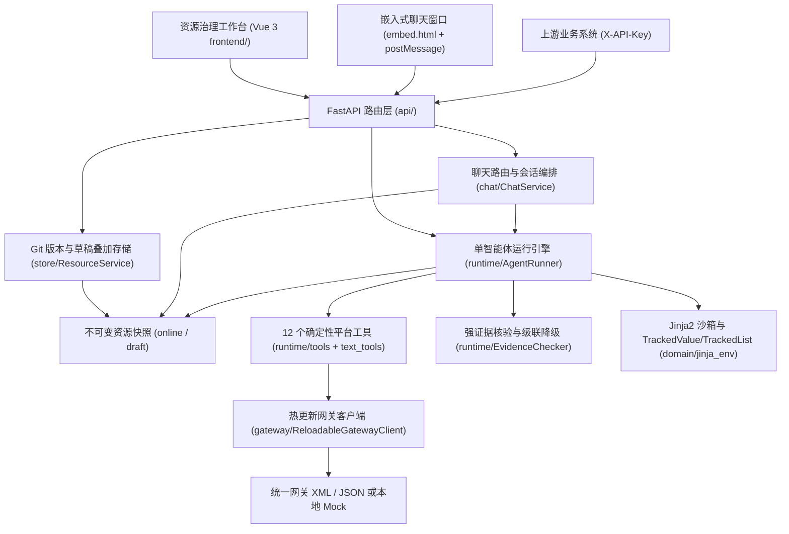

# 项目总览（`report-agent`）

<!-- #Created By AiCoding(codex) -->

`agent-python`（包名 `report-agent`）是面向电信投诉与申告核查场景的新一代**智能报告填写与资源治理全栈平台**。上游系统既可直接通过 HTTP/SSE 传入工单的电子协议单据文本（`document`）、结构化业务入参（`params`）与模板编号（`templateId`）生成报告，也可通过 iframe 嵌入交互式聊天窗口（`/embed.html`）由路由智能体推荐模板、对话补参并预览确认；平台驱动单智能体自主查阅业务 Skill、调用外部网关查询短信/充值流水/靓号档案、结合确定性工具提取转换数据，并在通过**强证据核验**后渲染输出规范的申告核查报告。

## 1. 核心设计哲学

1. **平台零业务硬编码**：`src/report_agent/` 平台源码不认识“订购短信”“受理渠道”或任何具体模板编号。平台只提供两样基础设施：**12 个确定性工具原语**（负责清洗、结构化查询、严格日期提取与偏移、账期展开、秒差计算、受控正则、日期格式化）与**字段级强证据核验引擎**；所有业务规则均外置为纯数据资源。
2. **单智能体统一上下文 + 严格结构化交卷**：摒弃多智能体串联带来的信息折损与重复网关调用，由单个 Pydantic AI `Agent` 在共享工作区 `Workspace` 内一次性完成所有字段推理与 `resultId` 复用，最终通过动态生成的严格 JSON Schema 工具 `submit_report` 交卷。
3. **不信任模型心算与自由发挥（Anti-Hallucination）**：
   - 凡涉及逐字引用的字段（`evidence: quote`），提交值必须在引用的接口记录单元格或单据原文中逐字出现；凡引用白名单格式转换工具 `format_date` 的推导字段（`evidence: derive`），提交值必须严格等于该工具输出的 `value`（或批量调用返回的 `values` 元素）；
   - 凡涉及多月展开、跨年日历推算、秒级时间差或正则捕获的环节，一律由平台确定性工具执行；
   - 交卷不合规自动触发 `ModelRetry` 打回重填，超限后精准降级违规字段并沿依赖图级联降级下游字段。
4. **不可变版本发布与可视化治理闭环**：内置完整的 Vue 3 资源工作台，支持模板、Skill、网关契约与系统提示词的草稿编辑、乐观锁防冲突、在线试运行（SSE 实时推理轨迹 + 证据溯源定位）、Git 版本化发布与毫秒级 `releases/current` 软链接紧急切换。

## 2. 与前代 Java 版（`pdf-agent-parse`）全局对比

| 维度 | 前代 Java 版（`pdf-agent-parse`） | 当前 Python 版（`report-agent`） | 演进收益 |
|------|----------------------------------|----------------------------------|----------|
| **Agent 编排** | `PlanAgent` → `SkillAgent`（按字段并发） → `KvAgent` 三阶段串联 | **单 `AgentRunner`** 全局统一规划 + `submit_report` 一次交卷 | 消除跨阶段上下文丢失；同一天短信查询 `resultId` 天然共享复用，大幅降低网关与 Token 开销 |
| **Skill 形态** | `SKILL.md` + `assembly.groovy` + `extract.groovy`（`GroovyScriptEngine` AST 沙箱） | **纯文本 `SKILL.md`** + **12 个平台确定性工具** | 彻底消除动态脚本沙箱逃逸风险与维护门槛；业务维护人员可直接在工作台阅读和调整规则 |
| **防幻觉机制** | 依赖 Groovy 硬编码抽取 + 服务层 `IntelligentComplaintServiceImpl` 多处特判兜底 | **`EvidenceChecker` 通用证据核验**（`quote`/`input`/`derive` + 列表逐行核验 + 级联降级） | 零业务特判代码，每个输出字段都附带可点击定位的接口行/单据行/入参证据链 |
| **网关接入** | Java 代码编写 `XmlBaseRequest` / WebClient 服务类 | **声明式 `apis/*.yaml`**（支持统一网关 XML Jackson 3 字节兼容模式、JSON 模式与 `${$now}` 占位符） | 新增外部接口只需编写 YAML 契约即可在工作台在线联调测试并热发布 |
| **模板引擎** | Pebble `3.2.2` + 独立 `.rule` 文件 + `field-mappings.yml` | **Jinja2 沙箱**（兼容 Pebble 换行裁剪与 `hasDigit`）+ 聚合单文件 `template.yaml` + `body.md.j2` | 字段定义、缺失策略、证据类型与规则集中在同一模板目录下，并通过 `TrackedValue`/`TrackedList` 精准计算 `SUCCESS`/`PARTIAL` |
| **资源存储** | Oracle 11.2 / OceanBase 资源表 + 轮询版本号重建快照 | **文件系统 + 内部 Git 仓库 + `releases/current` 原子软链接** | 零外部数据库依赖，天然具备完整行级 Diff、审计历史、草稿隔离与任意历史版本归档恢复 |

## 3. 当前仓库核心规模指标

| 指标项 | 数量 / 范围 | 代码与资源位置 |
|--------|------------|----------------|
| **生产报告模板** | **33 个**（ID `100` ～ `132`，全量发布静态校验 **0 error / 0 warning**） | `src/report_agent/seed/templates/100..132/` |
| **纯文本业务 Skill** | **12 个**（11 个填报取数/派生 Skill + 1 个嵌入式聊天路由 Skill `template-router`） | `src/report_agent/seed/skills/*/SKILL.md` |
| **声明式网关契约** | **3 个**（`querySMSSendInfo`、`BOSS_QryBalanceFlowLog`、`cc_pretty_num_info_query`） | `src/report_agent/seed/apis/*.yaml` |
| **确定性平台工具** | **12 个**（含资源/接口查询 3 个、文本清洗比对 2 个、日期时间与区间计算 6 个、受控正则 1 个） | `src/report_agent/runtime/tools.py`、`text_tools.py` |
| **前端构建入口与视图** | **双入口（`index.html` 工作台 + `embed.html` 聊天嵌入）**，涵盖登录、模板、工作台、Skill、接口、运行、回归、发布、设置与聊天模拟 | `frontend/embed.html`、`frontend/src/views/*.vue` |

## 4. 系统分层速览

## 相关页面

- [项目知识库总目录](index.md)
- [项目演进时间线](timeline.md)
- [单智能体请求处理管道](architecture/request-pipeline.md)
- [嵌入式聊天选模板窗口组件剖析](components/chat-embed.md)
- [强证据核验机制](architecture/evidence-system.md)
- [ADR-001：采用单智能体自主规划 + 强证据校验替代 Java 三 Agent 编排](decisions/adr-001-single-agent-and-evidence.md)
- [Java 行为差异与二期主动修复台账](lint/java-divergence.md)
