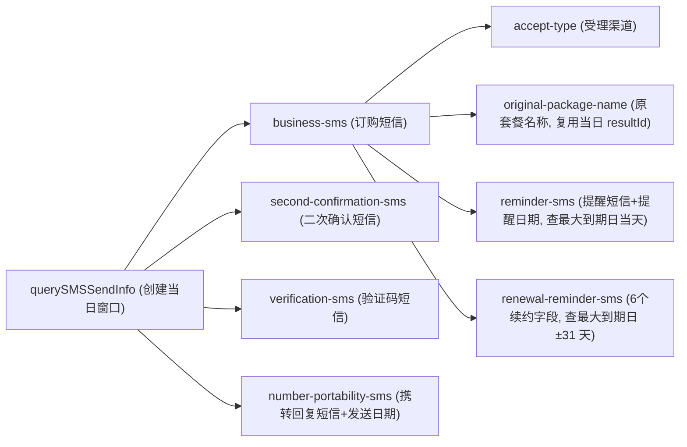

# 11 个纯文本业务 Skill 总览

<!-- #Created By AiCoding(codex) -->

`src/report_agent/seed/skills/` 内置了覆盖全部 33 个生产申告模板的 **11 个纯文本业务 Skill**。每个 Skill 仅由一个 `SKILL.md` 文件（YAML frontmatter + Markdown 操作手册）构成，不含任何可执行脚本；智能体在运行时通过 `load_skill` 按需加载，再组合平台提供的 [12 个确定性工具](../architecture/deterministic-tools.md) 完成取数、筛选、计算与证据提交。

## 1. 全量 Skill 矩阵

| Skill 标识 | 中文标题 | 关联网关接口 | 产出的模板字段 | 上游字段依赖 | 依赖的核心确定性工具 |
|------------|----------|--------------|----------------|--------------|----------------------|
| [business-sms](business-sms.md) | 订购短信（办理成功告知短信） | `querySMSSendInfo` | `订购短信` | — | `date_range`、`call_api`、`query_result(normalizedContains + before="编号")` |
| [accept-type](accept-type.md) | 受理渠道 | 无（纯派生） | `受理渠道` | `订购短信` | `text_contains(normalize=false)` |
| [second-confirmation-sms](second-confirmation-sms.md) | 二次确认短信 | `querySMSSendInfo` | `二次确认短信` | —（可复用当日 `resultId`） | `date_range`、`call_api`、`query_result`（两级优先级） |
| [verification-sms](verification-sms.md) | 验证码短信 | `querySMSSendInfo` | `验证码短信` | —（可复用当日 `resultId`） | `date_range`、`call_api`、`query_result` |
| [original-package-name](original-package-name.md) | 原套餐名称 | `querySMSSendInfo` | `原套餐名称` | `订购短信` | `query_result`、`time_diff`、`regex_extract` |
| [reminder-sms](reminder-sms.md) | 提醒短信与提醒日期 | `querySMSSendInfo` | `提醒短信`、`提醒日期` | `订购短信` | `extract_dates`、`date_shift`、`call_api`、`query_result`、`format_date` |
| [renewal-reminder-sms](renewal-reminder-sms.md) | 续约提醒短信 | `querySMSSendInfo` | `续约提醒类型`、`到期续约提醒时间`、`到期续约提醒短信内容`、`是否续约成功`、`续约成功提醒时间`、`续约成功提醒短信内容` | `订购短信` | `extract_dates`、`date_shift`、`regex_extract`、`call_api`、`query_result(anyOf=...)`、`format_date` |
| [number-portability-sms](number-portability-sms.md) | 携号转网告知提醒短信 | `querySMSSendInfo` | `发送日期`、`携转资格回复短信` | —（可复用当日 `resultId`） | `date_range`、`call_api`、`query_result`、`format_date` |
| [billing-cycle-sms](billing-cycle-sms.md) | 账期短信提醒列表 | `querySMSSendInfo`（逐月） | `账期短信提醒列表`（`list`，5 列） | — | `expand_period`、`call_api`、`query_result(resultIds=..., between)`、`format_date` |
| [qry-balance](qry-balance.md) | 充值流水（余额流水查询） | `BOSS_QryBalanceFlowLog`（逐账期） | `充值流水`（`list`，4 列） | — | `expand_period`、`call_api`、`query_result(resultIds=..., between, prefixLen=8)` |
| [pretty-number-info](pretty-number-info.md) | 靓号信息 | `cc_pretty_num_info_query` | `靓号等级`、`靓号活动名称`、`手机号类别` | — | `call_api`、`query_result` |

## 2. 上下游依赖与 `resultId` 共享拓扑

在单智能体共享工作区机制下：
1. **同日短信零重复调用**：同一个模板往往同时挂载 `business-sms`、`accept-type`、`second-confirmation-sms`、`verification-sms`（甚至 `original-package-name` 或 `number-portability-sms`）。它们对 `querySMSSendInfo` 的查询参数均为 `{手机号码, 创建时间当天 000000 ~ 235959}`，智能体只需在第一次调用 `call_api` 后直接复用同一个 `resultId`，把前代 Java 版的 4～5 次并发网关调用压缩为 **1 次**。
2. **显式字段证据链与引用分流**：推导类（`derive`）下游字段（如 `受理渠道`、`提醒日期`、续约提醒类型/时间）在 `evidence` 中显式附带 `{"type": "field", "name": "订购短信"}` 证据，使 `AgentRunner` 在 `订购短信` 证据核验失败降级时能够自动触发级联保护；原文引用类（`quote`）下游字段（如 `原套餐名称`、`提醒短信`）则按 `EvidenceChecker` 契约仅在 `evidence` 中填写命中记录的 `api` 证据，并在 `reasoning` 中说明上游 `订购短信` 依据。

## 3. 与前代 Java Groovy 版的演进差异概要

1. **去脚本化**：Java 版每个 Skill 拆分为 `SKILL.md` + `assembly.groovy` + `extract.groovy`；Python 版将参数组包收敛进声明式 `apis/*.yaml`，将抽取与算术逻辑收敛进平台确定性工具，业务侧只需维护一份可读的 Markdown。
2. **列表 0 行结果精确表达**：`billing-cycle-sms` 与 `qry-balance` 在各月网关均成功但无符合条件记录时，提交 `status="found", value=[]`（附成功调用证据），渲染为空且运行状态保持 `SUCCESS`，而任意月份接口报错则提交 `not_found` 准确标为 `PARTIAL`。
3. **历史缺陷主动修复**：二期已修复 Java Groovy 中的 `reminder-sms` 活动编号误识别日期（R2）、`qry-balance` 纯年月正则回溯丢流水（R8）以及 `pretty-number-info` 不核对号码/空等级误判靓号/多活动名无分隔符（R5），详见 [Java 行为差异与二期主动修复台账](../lint/java-divergence.md)。

## 相关页面

- [确定性平台工具设计](../architecture/deterministic-tools.md)
- [强证据核验机制](../architecture/evidence-system.md)
- [3 个内置网关接口契约速查](../reference/apis-catalog.md)
- [ADR-002：采用纯文本 SKILL.md + 平台确定性工具原语替代 Groovy 脚本引擎](../decisions/adr-002-text-skill-and-deterministic-tools.md)
- [Java 行为差异与二期主动修复台账](../lint/java-divergence.md)
